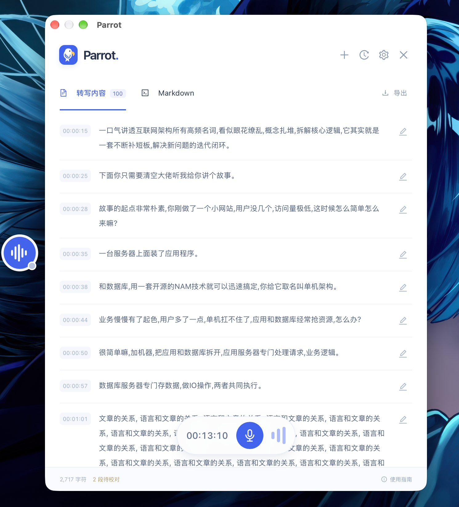
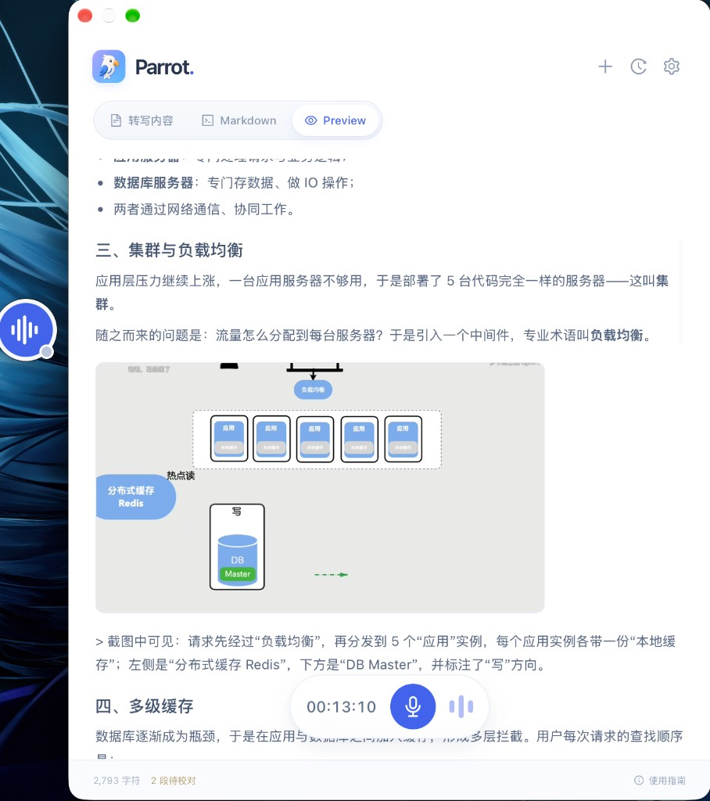

<h1 align="center">
  <picture>
    <source media="(prefers-color-scheme: dark)" srcset="docs/images/parrot-brand-dark.svg">
    
  </picture>
</h1>

<p align="center"><strong>把视频变成 Markdown，让 AI 帮你整理学习笔记。</strong></p>

<p align="center">为读写型学习者打造的视频学习工具，将视频中的语音与截图整理为 Markdown 文档，并借助 AI 提炼重点、梳理知识结构，生成可编辑、可回顾的学习笔记。</p>

## 一、demo展示

左侧是**原始转写**，右侧是 **AI 整理后的学习笔记**：从视频口播到 Markdown，在同一处完成记录、编辑与复习。

<p align="center">
  <a href="docs/images/demo-transcript.png"></a>
  <a href="docs/images/demo-study-notes.png"></a>
</p>

## 二、Parrot 是什么？

Parrot 是一款面向**读写型学习者**的 macOS 视频学习工具，将视频中的语音与手动截图整理为 Markdown 文档，并借助 AI 提炼重点、梳理知识结构，生成可编辑、可回顾的学习笔记。

观看课程时，点击桌面悬浮球开始聆听，让 Parrot 记录电脑正在播放的声音；遇到重要图表或演示，随手框选截图。课程结束后，在同一处完成文字编辑、AI 总结与 Markdown 导出，把视频里的讲解积累成自己的学习资料。

语音识别在本机运行，AI 润色连接你配置的模型服务。桌面能力由 Swift 实现，界面使用 Vue 3 + Ant Design Vue，转写与数据管理由 Python 负责。

## 三、支持的学习材料

- **电脑播放的视频与音频**：采集本机声音，适合在线课程、技术讲解与教程；戴耳机也能使用，无需虚拟声卡。
- **麦克风讲解**：记录自己的复述、课堂发言或口头补充，也可同时采集麦克风与本机声音。
- **屏幕中的图表与演示**：手动框选截图，插入当前记录，并随 Markdown 一起导出。

当前通过实时聆听采集内容，暂不支持直接导入音频或视频文件。原生客户端目前仅支持 macOS，已发布安装包为 Apple Silicon 版本。


## 四、下载安装

当前发布版本为 **v1.0.0**，适用于 **macOS 13+ / Apple Silicon**。

- **安装包**：[下载 Parrot-1.0.0-arm64.pkg](https://github.com/Alver-Lin/Parrot/releases/download/v1.0.0/Parrot-1.0.0-arm64.pkg)
- **版本记录**：[查看发布说明](https://github.com/Alver-Lin/Parrot/releases/tag/v1.0.0) · [浏览所有版本](https://github.com/Alver-Lin/Parrot/releases)

双击 `.pkg` 按提示安装，再从「应用程序」打开 Parrot。发行包已捆绑 Python，日常使用无需另外安装 Python 或 Node.js。首次使用需要下载语音识别模型，并授权所选音频来源；AI 润色需自行配置兼容接口。

升级安装保留个人记录与模型缓存。若 macOS 提示安装包未经公证，可在「系统设置 → 隐私与安全性」中允许打开。

## 五、功能特性

### 边看边记，保留原始材料

- **三种音频来源**：本机声音、麦克风或双声源混音，按学习场景切换。
- **本地 Whisper 转写**：支持中文、英语与自动语言检测；提供 Large v3、Turbo 和 Small 模型选择。
- **暂停与继续**：中途暂停不增加录制时长，恢复后接着同一条记录转写。
- **逐段编辑**：按时间标记查看转写内容，直接修正识别错误，保留原始转写供后续参考。
- **历史记录续写**：重新打开已有记录，追加新的讲解与截图。

### AI 整理，把口播变成学习笔记

- **清理口播噪声**：去除无关开场、宣传语与机械重复，修正有上下文依据的明显识别错误。
- **自动生成标题**：根据实际讲解提炼主题，用“一、二、三……”组织章节，保留关键概念、例子与适用条件。
- **结合截图理解内容**：支持图文输入的模型可识别截图，将图片放到相关段落旁，必要时添加图注。
- **长文分批处理**：较长课程分批整理，支持查看进度与取消。
- **预览后再应用**：并排查看原始版本与整理结果，点击「应用润色」后才更新文稿。
- **始终从原稿出发**：再次润色仍基于第一次润色前的原稿；点击「恢复原始版本」直接还原原始正文与标题。

### Markdown 文稿，继续编辑与复习

- **源码与预览切换**：直接编辑 Markdown 全文，随时查看排版效果。
- **自动保存**：修改自动保存，也可使用 `⌘S` 手动保存。
- **图文一起导出**：导出 `.md` 文档及配套 `photo/` 图片目录，便于继续整理和分享。
- **一键复制全文**：将当前文稿带入自己的笔记工具与知识库。
- **标题同步记录名称**：修改文稿开头的一级标题，历史记录名称随保存更新。

### 桌面悬浮球，随手开始学习

- **自由拖动**：悬浮球保持置顶，并记住上次放置的位置。
- **收起继续转写**：隐藏面板后，后台仍会采集与识别声音。
- **原生系统操作**：通过 macOS 完成权限授权、选区截图、剪贴板复制与文件导出。
- **菜单栏入口**：打开面板、进入设置或退出应用。

## 六、首次使用

1. **准备模型**：打开 Parrot，点击悬浮球展开面板，在设置中选择音频来源、语言和识别模型，完成模型下载与权限授权。
2. **开始聆听**：点击「开始聆听」，确认正在聆听后播放课程。需要时暂停，或收起面板继续学习。
3. **补充截图**：点击底部相机按钮框选重要画面。截图时面板会自动收起，再次点击悬浮球即可查看。
4. **整理笔记**：停止并等待转写完成，切换到 Markdown 页编辑文稿；在设置中配置 AI 的 Base URL、API Key 与模型名称，点击「测试连接」保存配置。
5. **生成与导出**：点击「AI 润色」，预览并应用结果，再复制全文或导出 Markdown。再次生成也会从原稿开始。

含截图的 AI 整理需要所选模型支持 `image_url` 图文输入。双声源模式建议佩戴耳机，避免麦克风重复录入电脑外放。完整操作说明见[使用指南](docs/usage.md)。

## 七、本地数据与隐私

**语音识别在本机完成，识别过程不上传音频。** 模型首次下载需要联网；识别使用的临时音频片段会在任务结束时清理，当前不提供完整录音保存或回听。

**AI 润色会将待整理的标题、正文与本地截图预览发送到你配置的模型服务。** 代码、表格、链接、公式与记录元信息通过占位符留在本机，返回后恢复。仅点击「测试连接」时发送简短固定请求，不发送学习文稿或截图。API Key 保存在 macOS 登录钥匙串中。

- **安装包版本的数据目录**：`~/Library/Application Support/Parrot/`
- **源码开发版本的数据目录**：项目下的 `.data/`
- **保存内容**：文字记录、Markdown 文稿、润色原稿、手动截图、元信息与模型缓存。

备份前先退出客户端，再复制数据目录。导出的文档若包含图片，移动或分享时请一并保留旁边的 `photo/` 文件夹。

## 八、常见问题

### 为什么开始聆听后没有马上出现文字？

Whisper 按音频片段识别，通常积累约 8–24 秒音频后输出一批文字。实际等待时间取决于设备与模型；首次加载或较慢设备可能需要更久，停止后也会继续处理剩余片段。

### 为什么转写出现错字、重复句或无关内容？

识别结果受音质、背景音乐、静音片段和专业术语影响，可能出现漏字、重复或无关内容。可先选择对应语言，尝试 Large v3，并在转写页直接修改；AI 整理也可能出错，原始转写仍会保留。

### 为什么采集不到电脑声音或无法截图？

请检查「系统设置 → 隐私与安全性 → 屏幕与系统音频录制」中的授权，必要时退出并重新打开 Parrot。麦克风模式另需麦克风权限；带 DRM 保护的媒体可能限制采集。

### 能重新生成笔记，或恢复最初的版本吗？

可以。每次 AI 润色都读取第一次成功应用前保存的原稿，不在上一次结果上继续改写。点击「恢复原始版本」会直接恢复原始正文与标题，重启后原稿仍然保留。

### 关闭窗口后，转写会停止吗？

关闭或收起面板只会隐藏窗口，后台继续转写。结束当前记录请点击停止按钮；退出应用请使用菜单栏中的「退出 Parrot」。

## 九、本地开发

需要 macOS 13+、Xcode Command Line Tools、Python 3.9+（建议 3.11/3.12），以及 Node.js 20.19+ 或 22.12+。

```bash
git clone https://github.com/Alver-Lin/Parrot.git
cd Parrot
bash scripts/setup.sh
bash scripts/start.sh
```

源码构建输出为 `dist/Parrot.app`，依赖项目中的 Python 环境；对外分发使用捆绑 Python 的安装包。构建、签名、发行打包及验证命令见[使用与构建指南](docs/usage.md#安装与构建开发)。

- [开发文档目录](docs/README.md)
- [客户端设计](docs/客户端设计文档.md)
- [模块与接口设计](docs/开发设计文档.md)
- [验证记录](docs/VALIDATION.md)

## 十、参与贡献

欢迎通过 [Issues](https://github.com/Alver-Lin/Parrot/issues) 反馈问题，或提交 Pull Request 改进功能。反馈时请附上 macOS 版本、芯片类型、识别模型、启动方式与复现步骤；日志或截图中请去除 API Key 及私人学习内容。
